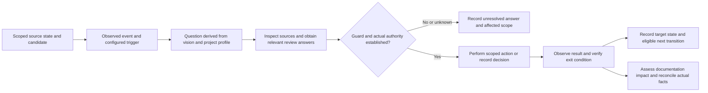
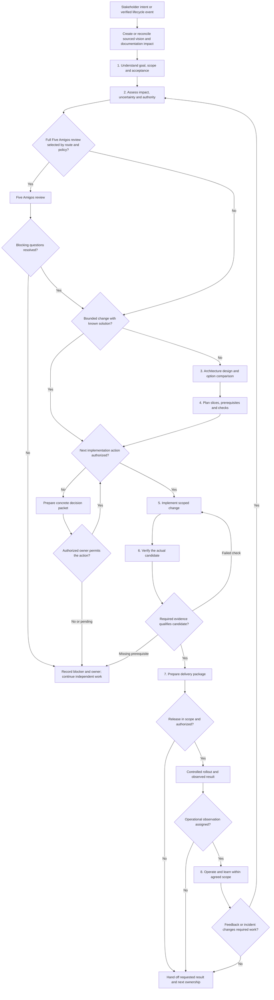
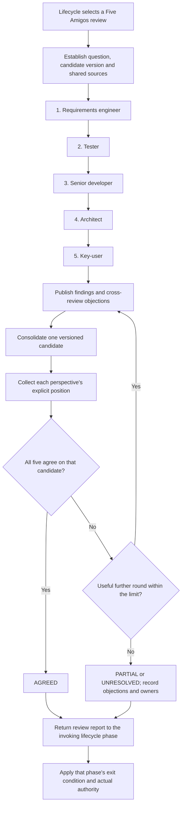

# AI-Assisted Software Lifecycle

Reusable workflow templates for deciding how an AI-assisted software task
starts, proceeds, is verified and reaches its delivery boundary. Adapt them to
the target project's triggers, constraints, decision owners and existing
authorization. Current status: first draft of the reference model; documented
workflows are not yet evidence of repeatable success in adopting projects.

## Purpose and reference model

Model how an ideal principal developer with fullstack and DevOps competence
works across requirements, architecture, implementation, test development,
delivery and operation. The ideal includes recognizing knowledge limits,
challenging assumptions, seeking appropriate expertise and correcting decisions
from evidence.

Separate two concerns:

| Concern | Purpose |
| --- | --- |
| Complete reference model | Identify the questions, methods, responsibilities and evidence a capable practitioner must be able to consider |
| Project-specific application | Select the relevant work from actual user needs, constraints, risks, existing decisions and authority |

Completeness belongs to the reference model. The concrete workload follows from
reasoned selection; a small correction need not execute the entire model.
Assess model completeness and application proportionality separately. The
coverage tree below exposes both existing coverage and remaining depth.

### Knowledge depth and personal reflection

A topic label or a named technique does not establish usable expertise.
Develop relevant branches through domain, subdomain, method, selection decision,
concrete application and evidence/reflection. Each developed method should make
clear when and why it applies, how to use it, what observations qualify its
result and what limitations or other perspectives remain.

This model also serves as a reflection of the author's knowledge and engineering
judgment. Keep described knowledge, reasoned decisions, practical application,
verified outcomes and transfer to other situations distinct. Personal competence
evidence and learning material belong in appropriate adopting projects or
training resources; the workflow repository retains process rules and references.

### Perspectives and execution

The principal developer coordinates requirements, key-user, architecture,
fullstack development, test engineering and DevOps/operations perspectives.
These are responsibilities a practitioner may switch between, not necessarily
separate people or agents. Follow dependencies sequentially; perform independent
work in parallel when inputs, ownership and contracts permit it. Reconcile the
results against a shared candidate.

Several role passes by one agent add viewpoints but do not establish independent
review or actual stakeholder validation. Use specialist input and real user
evidence where needed; select a full Five Amigos review only through the
lifecycle route and project policy.

| Workflow | Purpose | Main result |
| --- | --- | --- |
| [AI-Assisted Software Lifecycle](workflows/ai-assisted-software-lifecycle/WORKFLOW.md) | Overall process: route tasks through applicable phases and control consequential actions | Evidenced delivery with decisions, limitations and next ownership |
| [Five Amigos Lifecycle Review](workflows/five-amigos-round-table/WORKFLOW.md) | Optional lifecycle sub-process: resolve material uncertainty through five perspectives | One reviewed candidate, explicit positions and unresolved decisions |
| [Requirements-Driven Development and Verification](workflows/requirements-to-evidence/WORKFLOW.md) | Lifecycle workstream: develop user needs into requirements, acceptance, test design and qualified evidence | Traceable requirements, living test matrix and candidate-bound evidence |
| [Architecture Decisions and Evolution](workflows/architecture-design/WORKFLOW.md) | Lifecycle workstream: assess system structure, data, quality, integration, operation and change | Scoped decisions, tradeoffs, evidence needs, risks and transition plans |
| [Documentation-as-Code](workflows/documentation-as-code/WORKFLOW.md) | Cross-cutting lifecycle sub-process: connect stakeholder vision to delivery and independent events | Sourced AsciiDoc, bidirectional traceability and validation evidence |

The lifecycle selects when a Five Amigos review is useful. The review returns
its findings to the invoking phase; consensus alone does not authorize work or
establish that an implementation meets its acceptance criteria. The linked
workflow documents define the process rules; this README provides an overview.

## Knowledge and workflow coverage

This tree maps the reference model's current breadth and depth. It describes
workflow coverage and open development areas, not proven personal competence
or operational validation.

**✅ Documented process · 🆕 Added by the requirements-to-evidence change ·
◐ Partially described · ○ Further depth remains open**

The 🆕 entries were introduced by the merged
[PR #2](https://github.com/MatthiasBurger-Coder/ai-capabilities/pull/2).
They are part of `main`; 🆕 identifies their origin as recent additions, not an
open proposal.

Documented process coverage does not imply exhaustive treatment of its technical
discipline. Open branches indicate development directions, not supplied
capabilities or a commitment to add generic curricula to this repository.

```mermaid
flowchart LR
    Root["📁 Principal Engineering"]
    Root --> Process["📁 Process and collaboration"]
    Process --> Lifecycle["✅ Lifecycle"]
    Lifecycle --> LifecycleContent["States, events and trigger guards<br/>scope and authority<br/>blockers and handoffs"]
    Process --> Amigos["✅ Five Amigos"]
    Amigos --> AmigosContent["Shared sources and perspectives<br/>objections and consensus<br/>conditional full review"]
    Process --> Coordination["🆕 Roles and coordination"]
    Coordination --> CoordinationContent["Sequential dependencies<br/>parallel work<br/>shared candidate reconciliation"]
    Root --> Requirements["📁 Requirements development"]
    Requirements --> Need["🆕 User need"]
    Need --> NeedContent["Users and tasks<br/>problem and intended benefit<br/>sources, assumptions and non-goals"]
    Requirements --> Specification["🆕 Requirements"]
    Specification --> SpecificationContent["Business rules and states<br/>behavior and quality scenarios<br/>priorities, dependencies and revisions"]
    Requirements --> Acceptance["🆕 Acceptance criteria"]
    Acceptance --> AcceptanceContent["Preconditions and stimuli<br/>observable results<br/>oracle sources and failure cases"]
    Requirements --> RequirementsOpen["○ Further depth"]
    RequirementsOpen --> RequirementsOpenContent["Elicitation techniques<br/>domain modeling<br/>conflict resolution and validation"]
    Root --> Architecture["📁 Architecture"]
    Architecture --> Decisions["✅ Decision process"]
    Decisions --> DecisionsContent["Context and boundaries<br/>quality goals and options<br/>rationale and history"]
    Architecture --> Concerns["✅ Assessment concerns"]
    Concerns --> ConcernsContent["Structure, data and integration<br/>security and runtime<br/>deployment, costs and migration"]
    Architecture --> Hexagonal["◐ Hexagonal design checks"]
    Architecture --> ArchitectureOpen["○ Further depth"]
    ArchitectureOpen --> ArchitectureOpenContent["Concrete design methods<br/>distributed systems and failure models<br/>capacity models and measurement procedures"]
    Root --> Testing["📁 Test development"]
    Testing --> TestDesign["🆕 Test design"]
    TestDesign --> TestDesignContent["Criteria, risks and test data<br/>expected results and observation"]
    Testing --> Techniques["🆕 Technique selection"]
    Techniques --> TechniquesContent["Equivalence classes and boundaries<br/>decision tables and state transitions<br/>properties, failures and recovery"]
    Testing --> Pyramid["🆕 Test pyramid"]
    Pyramid --> PyramidContent["Unit and component<br/>contract and integration<br/>system and end-to-end<br/>level selection and limitations"]
    Testing --> Matrix["🆕 Test matrix"]
    Matrix --> MatrixContent["Criteria, risks and scenarios<br/>levels, paths and environments<br/>planned coverage and actual results"]
    Testing --> Evidence["🆕 Evidence assessment"]
    Evidence --> EvidenceContent["Candidate and environment<br/>failures and blockers<br/>validity, reuse and reruns"]
    Testing --> TestingOpen["○ Further depth"]
    TestingOpen --> TestingOpenContent["Detailed techniques and case studies<br/>mutation and combinatorial testing<br/>flaky tests and test maintenance"]
    Root --> Development["📁 Fullstack implementation"]
    Development --> Fullstack["🆕 End-to-end mapping"]
    Fullstack --> FullstackContent["Frontend and user interaction<br/>backend and business rules<br/>data and external interfaces"]
    Development --> Implementation["◐ Implementation ordering"]
    Implementation --> ImplementationContent["Bounded implementation slices<br/>TDD ordering"]
    Development --> DevelopmentOpen["○ Further depth"]
    DevelopmentOpen --> DevelopmentOpenContent["Frontend architecture and state<br/>backend patterns and transactions<br/>data migration and concurrency"]
    Root --> Operations["📁 DevOps and operations"]
    Operations --> Delivery["◐ Build, CI and configuration"]
    Operations --> Environments["🆕 Reproducible verification conditions"]
    Environments --> EnvironmentsContent["Build and candidate identity<br/>real and substituted dependencies<br/>missing prerequisites"]
    Operations --> Runtime["◐ Release and operation"]
    Runtime --> RuntimeContent["Release, rollout and recovery<br/>observability and incidents"]
    Operations --> OperationsOpen["○ Further depth"]
    OperationsOpen --> OperationsOpenContent["Pipeline design and Infrastructure as Code<br/>SLOs and operating models<br/>backup and recovery exercises"]
    Root --> Documentation["📁 Documentation and knowledge"]
    Documentation --> DocsCode["✅ Documentation as Code"]
    DocsCode --> DocsCodeContent["Sources and actual status<br/>arc42 and decision history<br/>relationships and change impacts"]
    Documentation --> Trace["🆕 Traceability"]
    Trace --> TraceContent["User need through verification evidence<br/>trace and test matrix templates<br/>illustrative walkthroughs"]
    Documentation --> Competence["○ Personal competence reflection"]
    Competence --> CompetenceContent["Knowledge and rationale<br/>application and evidence<br/>transfer to other situations"]
    Root --> AI["📁 AI-specific quality"]
    AI --> AIControls["◐ Quality controls"]
    AIControls --> AIControlsContent["Model and prompt versions<br/>output quality and non-determinism<br/>prompt injection and tool permissions<br/>data provenance and intervention points"]
    AI --> AIOpen["○ Detailed workstreams"]
```

Reassess this map whenever workflow scope changes. Base status changes on the
actual artifacts and distinguish defined methods from executed evidence.
The linked workflows remain the source of process rules; this map provides
navigation and a development overview.

## Shared transition model

All disciplines follow the same
[state-transition contract](workflows/ai-assisted-software-lifecycle/references/transition-model.md),
recorded with the [transition template](workflows/ai-assisted-software-lifecycle/templates/transition-template.md).
The vision and actual project profile determine relevant questions. Resolve them
through existing evidence or selected perspectives; use Five Amigos when the
lifecycle route selects the full review. The proposed/selected solution
determines process steps, event/trigger rules and documentation consequences.

Use this pattern for requirements, architecture, implementation, verification,
security/privacy, release, operation and documentation. Phase labels are work
areas rather than proof of state. A result can leave dependent documentation
pending; a proposal, review consensus, approval and actual execution remain
separate. This repository defines these routes without installing automation.

## AI-Assisted Software Lifecycle

The stakeholder vision is the starting document. The documentation sub-process
specifies how a target project connects vision, goals, requirements, stories,
the twelve-section arc42 core, decisions, implementation, verification,
deliverables, releases, user instructions, operations and security/compliance.
The documentation is created in the project applying this workflow.

Start from a concrete request or a verified event. Assess impact, uncertainty,
reversibility and authority, then choose a proportionate path. Small, clear
changes can use a short path; cross-cutting changes need explicit design and
planning. Record why phases or checks do not apply.

The diagram shows the main path. Failures or changed requirements return to
the affected phase, which may be assessment, design or implementation. At every
phase, check the authority for the next action; the implementation decision
node illustrates this rule. Existing authorization remains valid within its
scope. A new phase or an event does not itself require fresh approval.

Verification is selected from acceptance criteria, project rules and risk.
Missing required checks stay blocked; they do not become passes or exclusions.
Task completion, release readiness, release authorization and observed deployment
are separate results. An implementation request does not imply deployment or
continuous monitoring authority.

## Five Amigos Lifecycle Review

Invoke this review when the lifecycle route and project policy require alignment
on material scope, user-workflow, architecture or acceptance questions. Use the
same candidate and source packet for all perspectives.
Include the vision, actual project profile, question IDs and the transition
guard each answer affects. The report returns answers and process/documentation
implications to the invoking discipline.

| Perspective | Review focus |
| --- | --- |
| Requirements engineer | Scope, criteria, conflicting interpretations and synthesis |
| Tester | Observable outcomes, verification needs and evidence gaps |
| Senior developer | Implementation path, feasibility and prerequisites |
| Architect | System impacts, ownership, contracts and governing constraints |
| Key-user | Actual daily-work evidence and remaining user-validation needs |

Sequential perspectives are the default. Authorized independent agents can
review in parallel or batches when the runtime supports it. Show actual
contributions and meaningful responses, and identify whether they came from
people, separate agents or one agent performing role passes.

The default is one shared discussion and final confirmation, with one further
round only when evidence or a concrete revision could resolve an objection.
Consensus is tied to the same candidate version. Silence, missing reviews and
simulated key-user perspectives do not establish human approval or user validation.

## Adopt the templates

Copy `workflows/` into the target repository, preserving the relative links or
adapting them to its conventions. Configure only the controls relevant to that
project and task.

1. Adapt the [project lifecycle policy](workflows/ai-assisted-software-lifecycle/templates/project-policy-template.md)
   with trusted events, trigger conditions, decision rights, applicable checks
   and real decision owners.
2. Use the [lifecycle work record](workflows/ai-assisted-software-lifecycle/templates/work-record-template.md)
   to retain task scope, phase results, decisions, evidence and handoff status.
3. Attach a [Five Amigos report](workflows/five-amigos-round-table/templates/report-template.md)
   when the selected route includes a review.

See the [routing examples](workflows/ai-assisted-software-lifecycle/references/routing-examples.md)
for bounded changes, unclear requirements, missing prerequisites and existing
release authorization.

These Markdown files guide the process. Automated event handling, technical
permissions, CI checks and release enforcement must be configured in the target
environment. Copying the templates does not activate agents or run actions.

## Documentation lifecycle

Use the [Documentation-as-Code workflow](workflows/documentation-as-code/WORKFLOW.md)
throughout development and when independent events change documented facts.
Its [documentation plan template](workflows/documentation-as-code/templates/documentation-plan-template.md)
defines the proposed chapter structure, source/status records and relationships.
The [vision template](workflows/documentation-as-code/templates/vision-template.adoc)
captures the stakeholder's initial intent without implying approval.

## Requirements-driven development and verification

The [requirements-to-evidence workstream](workflows/requirements-to-evidence/WORKFLOW.md)
connects user need, developed requirements, acceptance criteria, test design,
a living test matrix, implementation and qualified evidence. It spans existing
lifecycle phases rather than adding a mandatory waterfall or approval gate.
Requirements and test development are continuing workstreams alongside
architecture and implementation. Test design may reveal unclear expectations
or poor testability and return work to requirements or architecture.

The test pyramid selects effective verification levels; the test matrix checks
coverage across criteria, risks, components/interfaces and relevant quality
attributes. Many unit tests alone do not establish requirement or integration
coverage. Planned coverage stays separate from actual execution and valid evidence.

An event records an observed fact. A trigger combines that event with the
source state, affected revision and guard to select work; it does not grant
authority or prove an action succeeded. Requirement changes reassess dependent
criteria, tests, implementation and evidence while preserving valid independent
results.

Adopt its [trace template](workflows/requirements-to-evidence/templates/requirement-trace-template.md)
and [test matrix](workflows/requirements-to-evidence/templates/test-matrix-template.md)
or reuse equivalent project artifacts. Product/test work can be sequential or
parallel with explicit dependencies. Requirement changes reopen affected evidence;
qualified scoped evidence returns to the lifecycle's overall candidate assessment.

## Architecture decisions and evolution

The [architecture workstream](workflows/architecture-design/WORKFLOW.md) covers
business alignment, context, quality scenarios, software structure, data,
integration, security/privacy, runtime performance, deployment, reliability,
technology/cost choices, migration and decision governance. Select the concerns
affected by the task rather than prescribing a full redesign.

Hexagonal architecture is one proposed internal application design approach.
Its [specific checks](workflows/architecture-design/references/hexagonal-design-checks.md)
apply only where that choice is evaluated or selected. They do not determine
deployment topology, data architecture or the operating model.

The [assessment/design template](workflows/architecture-design/templates/architecture-design-template.adoc)
and [decision template](workflows/architecture-design/templates/architecture-decision-template.adoc)
record the selected concerns and feed the target project's arc42 documentation.
Actual authority, product choices and executed evidence remain distinct.

This repository contains workflow definitions and templates only. Product code,
actual product documentation, tests, renderers, CI and deployments belong to the
project adopting the process. Verification steps describe what that project
must establish; they are not executable tools supplied by this repository.
