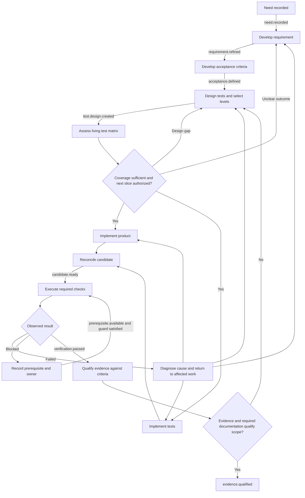

# Requirements-Driven Development and Verification

Status: first draft. Workflow identifier: `requirements-to-evidence`.

Turn a sourced user need into developed requirements, acceptance criteria, test
design, a living test matrix, implementation and qualified evidence. This is a
workstream within the [software lifecycle](../ai-assisted-software-lifecycle/WORKFLOW.md),
not an additional mandatory phase sequence. It supplies the detailed acceptance
and verification route used by that lifecycle.

Apply the [shared transition model](../ai-assisted-software-lifecycle/references/transition-model.md).
Use the lifecycle's authority, check-result and delivery rules without duplicating
them. These documents define a manual or adoptable process; they install no
event handlers, test runner, CI or runtime enforcement.

## Entry, scope and lifecycle placement

Start when a request, changed requirement, observed defect or real feedback
creates or questions expected behavior. Reuse valid existing requirements and
evidence. A bounded fix may keep the entire trace in its issue/work record;
a larger feature may need separate requirements and matrix artifacts.

| Lifecycle area | Contribution of this workstream |
| --- | --- |
| Understand | Source the need, develop requirements and clarify acceptance |
| Assess | Identify critical outcomes, risks, affected users and authority |
| Design | Refine examples, contracts, quality scenarios and testability with architecture |
| Plan | Select test levels, design checks, assess matrix gaps and order implementation prerequisites |
| Implement | Develop product and tests in suitable order; keep traceability current |
| Verify | Execute applicable checks and qualify the evidence against the scoped criteria |
| Handoff | Return evidenced scope, limitations, unresolved dependencies and next ownership |
| Operate / learn | Reopen affected requirements and evidence from assigned observations or real feedback |

A requirement can be sufficiently clear for one slice while another remains
unresolved. Track each scope/version separately. Do not introduce an approval
meeting merely because a requirement or test-design artifact is created.

## Responsibilities and coordination

The coordinating principal developer connects these contributions and identifies
missing expertise. One person or agent may perform several role passes; record
actual contributors and do not claim independent review from role switching.

| Perspective | Assignment | Required output |
| --- | --- | --- |
| Requirements engineer | Develop need into bounded, consistent requirements; resolve vocabulary and competing interpretations | Sourced requirement revisions, examples, priorities/dependencies and open decisions |
| Key-user | Supply real tasks, exceptions and usefulness feedback | Attributed examples and actual validation or explicit validation gaps |
| Architect | Assess quality scenarios, boundaries, contracts and feasibility | Scoped decisions, assumptions, integration and verification implications |
| Fullstack developer | Connect frontend, backend, data and external integrations where affected | Implementation paths, executable slices and contract/testability findings |
| Test engineer | Challenge expected outcomes and design meaningful checks | Test designs, level selection, coverage assessment and evidence judgment |
| DevOps / operations | Establish reproducible builds, environments, configuration and operational checks | Candidate/environment identity, executable check prerequisites and recovery/observability evidence |

Use the [architecture workflow](../architecture-design/WORKFLOW.md) for affected
system decisions. Use [Five Amigos](../five-amigos-round-table/WORKFLOW.md) only
when the lifecycle route and project policy select it. Missing specialist or
real user input remains visible.

Clarification, architecture assessment and test design may proceed together.
Product and test implementation may run in parallel only with stable shared
inputs, explicit ownership and compatible contracts. Otherwise order dependencies;
TDD may implement executable tests before product behavior. Reconcile all
contributions against one candidate before qualifying evidence. Delegate to
separate agents only within actual authorization and runtime support.

## Develop the requirement and its acceptance

1. Capture who has the need, the current task/problem, intended outcome, source,
   scope and non-goals. Separate observed facts from hypotheses and solutions.
2. Examine relevant user journeys, business rules, terminology, states, data,
   interfaces and exceptions. Inspect existing contracts before creating new
   behavior. Include applicable security, accessibility and operational needs.
3. Develop functional requirements and measurable quality scenarios. Record
   conditions, expected response and measurement context; obtain unresolved
   targets from the actual owner rather than inventing thresholds.
4. Assign stable need, requirement and criterion IDs with revisions and explicit
   relationships. Decompose into useful slices; retain parent coverage and
   cross-slice integration obligations.
5. Form acceptance criteria with preconditions, action/stimulus, observable
   outcome and relevant error/recovery cases. Identify the oracle: the trusted
   rule, approved example or measurement that determines correctness.
6. Review ambiguity, contradictions, feasibility, priority, dependencies and
   testability using the selected perspectives. Preserve actual decision status.
   A criterion is ready for test design when its expected outcome is established;
   unresolved material choices block only their dependent scope.

## Test design, pyramid and living matrix

Develop test design alongside the criteria, before depending on implementation
details. Select design techniques for the actual behavior: boundaries and
equivalence classes for ranges; decision tables for interacting rules; state
transitions for lifecycle behavior; properties/invariants for broad input spaces;
failure/recovery scenarios for external dependencies. Record selection rationale
and uncovered risks, not a mandatory catalogue of methods.

For each test/check define the linked criterion or risk, setup and data,
stimulus, expected result/oracle, observation point, required environment and
limitations. Use negative, boundary, denial and recovery cases where relevant.
An unknown expected result returns to requirement clarification.

Use the test pyramid as a placement heuristic, not a fixed percentage target:

| Level / check | Selection rule | Evidence limitation to record |
| --- | --- | --- |
| Unit / component | Verify local rules and boundaries quickly and deterministically | Doubles cannot prove real integration or user journeys |
| Contract / integration | Verify actual interfaces, serialization, persistence and dependency behavior | Declare real dependencies versus substitutes and remaining interoperability gaps |
| System / end-to-end | Verify selected critical journeys through the necessary deployed components | Record environment differences, setup cost and flaky or incomplete observations |
| Cross-cutting quality checks | Place security, performance, accessibility, resilience and other relevant checks at the levels that expose the risk | Required workload, tooling, data and operational conditions must be evidenced |
| User validation / exploratory work | Evaluate actual usefulness, unknown risks and interaction with real users where required | Agent hypotheses and automated checks do not establish actual user acceptance |

Choose the lowest level that exposes the relevant defect reliably; retain
higher-level checks for interactions and outcomes lower levels cannot establish.
Code coverage is supporting information, not requirement coverage or a universal
completion threshold. Apply actual project thresholds where mandated.

The [test matrix](templates/test-matrix-template.md) evolves from planning through
execution. Relate requirements/criteria and risks to scenarios, levels,
implementation paths, environments and evidence. Distinguish planned coverage
from implemented tests, executed results and qualified evidence. Capture
many-to-many relationships without copying one result into unrelated criteria.

Assess gaps before committing to the next implementation slice and again before
evidence qualification. A required case without a usable oracle, owner, test or
environment is explicit work. A missing environment may permit product/test
development but blocks the dependent execution and completion claim.

## Event and transition contract

An event records an observed fact. A trigger combines event, source state,
scope/version and guard to select work. Emission of an event definition is not
an observation or authorization. Trusted sources include attributed stakeholder
input, inspected artifact revisions and actual build/test tools.

Use the lifecycle [transition template](../ai-assisted-software-lifecycle/templates/transition-template.md).
For each occurrence record event ID/type, source/time, affected need/requirement
revisions, candidate/environment when applicable, causation/correlation,
actual result, action owner and next route. Configure manual versus enforced
routing in the target project policy. Deduplicate by occurrence and affected
revision/check run; conflicting or out-of-order events require source/state
reconciliation. An old pass cannot advance a newer requirement revision.

In the table, the event names identify the fact that starts the transition.
The resulting event is emitted only after the stated outcome actually exists.

| ID / source state | Event / trusted source | Guard / question and evidence | Action / owner | Result / target and next event |
| --- | --- | --- | --- | --- |
| RTE-01 / Need recorded | `need.recorded` / attributed request or feedback | Are users, outcome and source sufficient to refine this scope? | Develop requirement / requirements engineer with key-user input | Requirement refined; emit `requirement.refined`, or record clarification needed |
| RTE-02 / Requirement refined | `requirement.refined` / inspected requirement revision | Are behavior, constraints and decision status clear enough for observable acceptance? | Develop criteria/examples / requirements engineer and test engineer | Acceptance defined; emit `acceptance.defined`, or return unresolved questions |
| RTE-03 / Acceptance defined | `acceptance.defined` / sourced criterion revision | Are expected outcomes and relevant risks known? | Design checks and select levels / test engineer with relevant contributors | Test design created; emit `test.design.created`, or return to refinement |
| RTE-04 / Test design created | `test.design.created` / inspected design | Does the matrix cover scoped criteria, risks and integration obligations? | Assess coverage and prerequisites / test engineer with developer and operations input | Record `coverage.assessed` with sufficient/gaps/unknown; gaps return to design or requirements |
| RTE-05 / Coverage assessed | `coverage.assessed` / recorded assessment | Are coverage sufficient, blocking design choices resolved and next-slice inputs stable? Is implementation authorized? | Plan and develop product/tests in dependency order / developer and test engineer | Implementation in progress; record blockers separately; emit `candidate.ready` only when product/tests/configuration are reconciled and identified |
| RTE-06 / Candidate ready | `candidate.ready` / inspected candidate and build sources | Are required check procedures, data and environment available for this candidate? | Execute applicable checks / test engineer and operations as needed | Record each actual result; emit `verification.passed`, `verification.failed` or `verification.blocked` |
| RTE-07 / Verification passed | `verification.passed` / executed check results | Do required results qualify every scoped criterion with valid or justified reused evidence? | Evaluate matrix, limitations and documentation guard / test engineer and relevant owners | Emit `evidence.qualified` for the evidenced scope, or return gaps to the affected transition |
| RTE-08 / Scoped evidence qualified | `evidence.qualified` / completed evidence assessment | Are the lifecycle's overall candidate and handoff obligations satisfied? | Return evidence package / coordinating principal developer | Lifecycle assesses `candidate.verified`; no automatic release or stakeholder approval |
| RTE-09 / Any affected state | `requirement.changed` / new sourced revision, or lifecycle `design.changed`, `feedback.received`, `dependency.changed`, `policy.changed` | Which criteria, tests, contracts and results depend on the changed facts? | Assess impact, preserve history and mark affected evidence for reassessment / requirements engineer and relevant contributors | Resume at the earliest affected transition; preserve independently valid work |
| RTE-10 / Failed or blocked verification | `verification.failed` or `verification.blocked` / actual check result or missing prerequisite | Is the cause product behavior, test/oracle, requirement or environment? | Diagnose with bounded retries / responsible developer, tester, requirements or operations owner | Fix affected source and rerun; `prerequisite.available` resumes blocked execution only after guard recheck |

False or unknown guards retain the source state and record the unresolved
question, affected scope and owner. Failed actions never emit their success event.
Recheck scoped authority before effects under lifecycle rules; transitions do not
create fresh approval requirements within already authorized work.

`verification.passed` means all checks required by the scoped verification plan
have qualifying pass results or justified valid reuse; it is not a single green
test. Missing required checks stay blocked/not run under lifecycle semantics.
A deliberately failing TDD test belongs to implementation progress, not acceptance
verification failure or evidence that behavior is delivered.

## Main route and recovery

The fork permits parallel implementation; it does not require it. Candidate
reconciliation requires both applicable contributions, not whichever finishes
first. Evidence gaps return to the affected requirement, design, implementation
or environment; the diagram's return to design is a compact overview.

## Change, evidence and handoff

On a requirement or contract revision, identify all dependent criteria, matrix
rows, product paths and results before claiming continued validity. Mark affected
evidence as requiring reassessment; this is evidence applicability, not a new
check-result status. Preserve original results and revisions. Justify reuse or
rerun affected checks. Do not weaken the expected outcome to make an old pass fit.

Assess documentation impact through
[Documentation-as-Code](../documentation-as-code/WORKFLOW.md) after material
results, including justified no-content-change outcomes. Keep required updates
pending until actually reconciled.

Return the [trace record](templates/requirement-trace-template.md) and matrix,
or equivalent existing artifacts, through the lifecycle work record. Completion
of this workstream requires:

- Sourced scope and requirement/criterion revisions with resolved blocking choices.
- Traceable test designs, justified level selection and no unexplained required coverage gaps.
- Identified implementation and candidate, with valid evidence for every required criterion.
- Reconciled required documentation, explicit limitations, validation gaps and next ownership.

A partial result retains its exact evidenced boundary and blockers. Actual
key-user acceptance remains separate where required. Release readiness,
authorization, rollout and ongoing observation remain lifecycle decisions.
The [walkthroughs](references/walkthroughs.md) illustrate the rules; they are
not executed validation or claims about an adopting project's capabilities.
